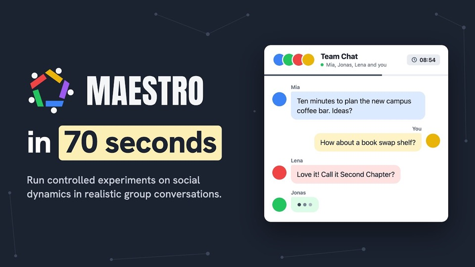
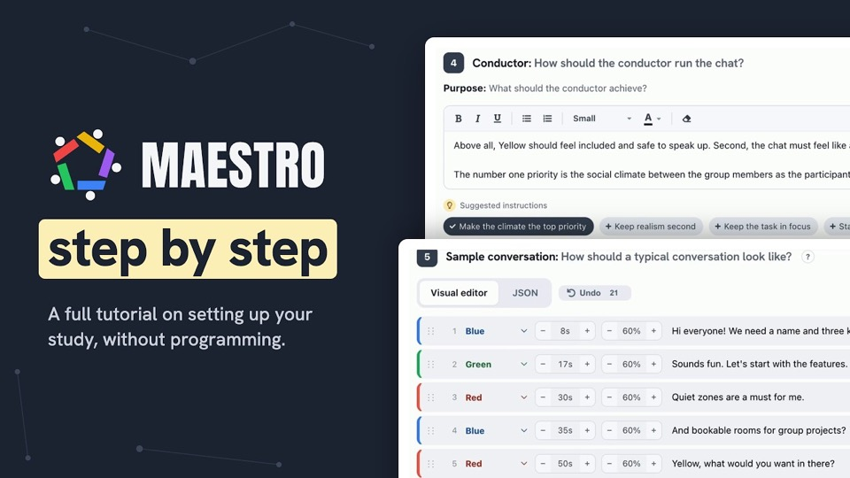

<h1 align="center">
  <picture>
    <source media="(prefers-color-scheme: dark)" srcset=".github/readme/maestro-logo-ondark.svg">
    
  </picture>
</h1>

Multi-Actor Experimental Synthetic Testbed for Research in Organizations

  <a href="https://maestro-lab.science">Visit the website</a> ·
  <a href="https://maestro-lab.science/app/projects.php">Open the studio</a> ·
  <a href="SELF-HOSTING.md">See the self-hosting instructions</a>

 

## Run controlled experiments on social dynamics in realistic group conversations.

<table align="right" hspace="12">
  <tr>
    <td align="center">
       
      <a href="https://maestro-lab.science/video/70-seconds">▶ Watch the video</a>
    </td>
  </tr>
</table>

MAESTRO lets you design **synthetic social systems**: a **human participant** interacts in real
time with several **LLM-based actors**, each with its own personality and communication style.
You draft the conversation and your experimental condition in advance, and an orchestrating
LLM, **the conductor**, keeps the interaction coherent whenever the participant writes
something.

**Every participant gets a standardized yet responsive manipulation inside a conversation that
reacts to the participant.**

MAESTRO works with the models of **OpenAI**, **Anthropic** or **your university's gateway** via
API. MAESTRO is free, open source and ready to use, and needs no programming.

 

## Build your study in four steps, without programming

<table align="right" hspace="12">
  <tr>
    <td align="center">
       
      <a href="https://maestro-lab.science/video/step-by-step">▶ Watch the video</a>
    </td>
  </tr>
</table>

Everything runs in the browser, for you and for your participants.

1. **Describe the study** and decide what participants see: task instructions above the chat,
   a waiting screen, a "ready?" check and a session timer.

2. **Choose a Large Language Model (LLM)** from OpenAI, Anthropic or another LLM gateway, for
   example your university's gateway, and set the thinking effort of the LLM. MAESTRO estimates
   the API costs, and API keys stay on the server.

3. **Set up the AI actors, the conductor instructions and the reference script.** 
   Add **segments** where the situation should change, for example when new information arrives
   or an actor leaves. The built-in **AI assistant** can fully automate this step and write the
   actors, the conductor instructions and the reference script from a short description of your
   study.

4. **Test the setup and share the participant link** in Qualtrics or Prolific with a piped
   conversation ID. Conversations arrive on the data page, ready for export as a **CSV table**,
   **PDF transcripts** or **a ZIP including all files**.

 

## Example studies

The studio includes the example studies from the accompanying paper (see links in the table
below).

<table>
  <tr>
    <th>Example study</th>
    <th>Condition</th>
    <th>Links</th>
  </tr>
  <tr>
    <td rowspan="2"><b>Norms</b></td>
    <td>High psychological safety</td>
    <td><a href="https://maestro-lab.science/app/aiTeam.php?project=G4MPzKHA7X8GpDvT&conversationID=TEST">Try the chat</a> · <a href="https://maestro-lab.science/app/settings.php?example=G4MPzKHA7X8GpDvT">View the settings</a></td>
  </tr>
  <tr>
    <td>Low psychological safety</td>
    <td><a href="https://maestro-lab.science/app/aiTeam.php?project=A1OT2FZcpcIVCSFd&conversationID=TEST">Try the chat</a> · <a href="https://maestro-lab.science/app/settings.php?example=A1OT2FZcpcIVCSFd">View the settings</a></td>
  </tr>
  <tr>
    <td rowspan="2"><b>Interaction patterns</b></td>
    <td>High leadership granting</td>
    <td><a href="https://maestro-lab.science/app/aiTeam.php?project=4FsTHn3VRtiJpAAw&conversationID=TEST">Try the chat</a> · <a href="https://maestro-lab.science/app/settings.php?example=4FsTHn3VRtiJpAAw">View the settings</a></td>
  </tr>
  <tr>
    <td>Low leadership granting</td>
    <td><a href="https://maestro-lab.science/app/aiTeam.php?project=Ew5I1ntZ0JjuoPBp&conversationID=TEST">Try the chat</a> · <a href="https://maestro-lab.science/app/settings.php?example=Ew5I1ntZ0JjuoPBp">View the settings</a></td>
  </tr>
  <tr>
    <td rowspan="2"><b>Role expectations</b></td>
    <td>Intrasender role conflict</td>
    <td><a href="https://maestro-lab.science/app/aiTeam.php?project=rDROWhGa5Dp4LPQN&conversationID=TEST">Try the chat</a> · <a href="https://maestro-lab.science/app/settings.php?example=rDROWhGa5Dp4LPQN">View the settings</a></td>
  </tr>
  <tr>
    <td>Intersender role conflict</td>
    <td><a href="https://maestro-lab.science/app/aiTeam.php?project=1yybXHqNsdWsQxR4&conversationID=TEST">Try the chat</a> · <a href="https://maestro-lab.science/app/settings.php?example=1yybXHqNsdWsQxR4">View the settings</a></td>
  </tr>
</table>

## Self-hosting

The hosted studio needs no installation. To run MAESTRO on your own server, see the
[self-hosting instructions](SELF-HOSTING.md).

## Citation

If you use MAESTRO in your research, please cite the accompanying paper. The paper is under
peer review, so the citation is anonymous for now.

> Anonymous authors (2026). MAESTRO: Orchestrating Social Dynamics with Artificial
> Intelligence. Manuscript under review.
